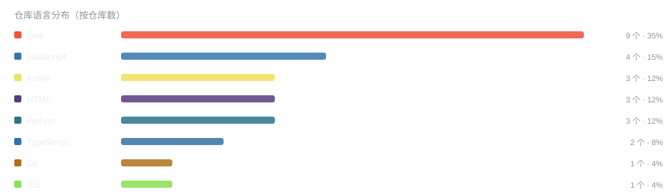

# Hi, I'm xisohi 👋

全栈开发者 · IPTV 直播源维护者 · Android/机顶盒折腾家 · 黑苹果玩家

- 🔭 正在维护：**[CHINA-IPTV](https://github.com/xisohi/CHINA-IPTV)** —— 大陆可用的电视直播源合集与 EPG
- 📱 Android：XHYSTV（直播聚合）、MusicFree 插件生态
- ☕ Java 后端：Spring Boot 企业系统（养老 OA / WMS）
- 🍎 黑苹果：OpenCore / UHD 630 双屏 / EDID 修复
- 车机语音助手：
- ✍️ 博客：**[blog.xisohi.com](https://blog.xisohi.com)**

## 📊 GitHub 数据（每日自动更新）

